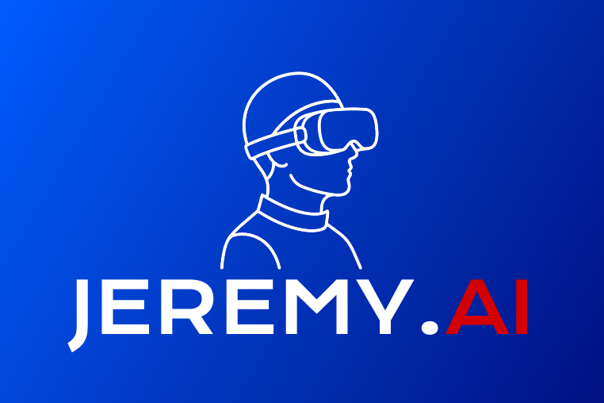
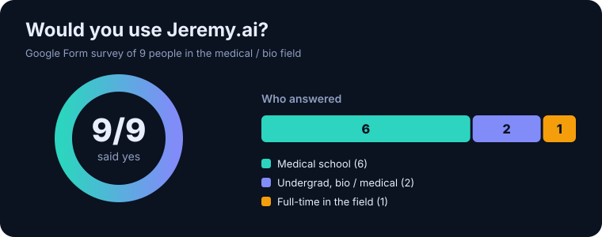
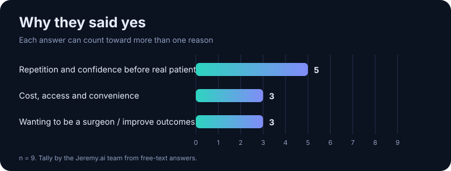
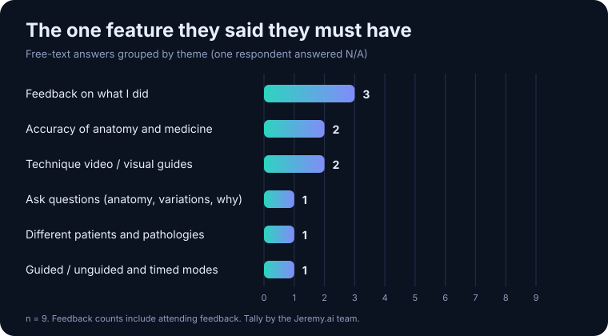
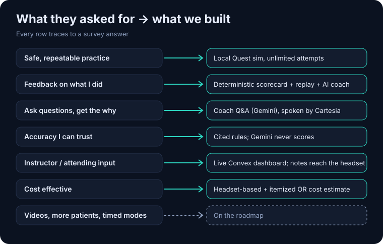
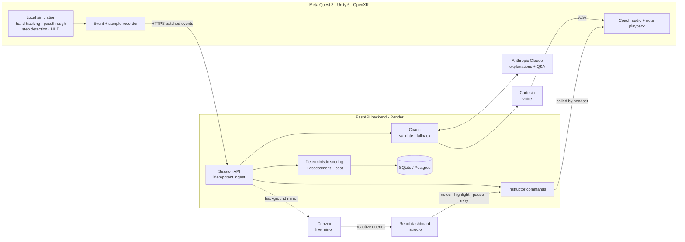

<div align="center">

<h1></h1>

### Surgical practice you can repeat until it's perfect, for the price of a headset.

**An AR surgical-training simulator for Meta Quest 3, with a voice coach that watches your hands, a deterministic scorecard you can trust, and a live instructor window into every attempt.**

<br/>

[](#-the-experience)
[](#-tech-stack-and-where-each-piece-earns-its-place)
[](#anthropic-claude--the-tutor-that-explains-never-the-judge-that-scores)
[](#apify--real-prices-behind-the-cost-estimate)
[](#cartesia--the-coach-speaks)
[](#convex--the-live-instructor-window)
[](#-architecture)
[](#-the-instructor-dashboard)
[](#-live-deployment)

**Built at CalHacks 13**

[**Live site**](https://jeremywantstobeasurgeon.us/) · [**Source**](https://github.com/ShawnJoshua03/Jeremy.ai) · [**API docs**](https://api.jeremywantstobeasurgeon.us/docs) · [**Architecture**](docs/ARCHITECTURE.md) · [**Demo script**](docs/DEMO_SCRIPT.md) · [**Honest status**](docs/STATUS.md)

</div>

---

## The problem

Every surgeon was once a trainee who had to learn on someone else's body.

- **Reps are scarce.** Students and residents only get as many supervised cases as the schedule allows. Simulators that give unlimited reps are scarce, expensive, and live in a lab down the hall.
- **Feedback is rare and subjective.** An attending is busy, the OR is loud, and "that was fine" isn't a measurement.
- **Mistakes are expensive.** Operating-room time costs real money by the minute, and one intraoperative adverse event can add five figures to a hospital bill. Learning by doing on patients is the *only* way many students ever get repetitions.

## The idea

**Put the operating room on your desk.** Jeremy.ai turns a $500 headset into a surgical skills lab. You pick up virtual instruments with your bare hands, practice real procedural steps over and over, and get instant, measurable, explainable feedback. A human instructor can watch live from any browser and nudge you in the moment.

> Practice with zero chance of hurting anyone. Know *exactly* where you lost points. Ask "why?" out loud and get an answer.

---

## What medical students told us

Before writing the voice and coaching features, we surveyed people in the field through a Google Form: **9 respondents** (6 medical students, 2 pre-med / bio undergrads, 1 full-time bio/medical professional).

### **9 out of 9 said yes**, they would use Jeremy.ai.

<p align="center"></p>

Their reasons clustered tightly:

<p align="center"></p>

And the one feature each said they must have:

<p align="center"></p>

How each theme maps to the product:

<p align="center"></p>

The detail:

| What they said they want | Said by | What we built for it |
|---|---|---|
| **Unlimited safe repetitions** before touching real patients | 5 of 9 | Unlimited local sessions on a headset. Nothing about it needs a lab, a cadaver or a booking. |
| **Feedback on what I did** | 3 of 9 | A deterministic scorecard after every attempt, a replay with errors highlighted, and an AI coach that explains the *why* |
| **A way to ask questions** (anatomy, variations, "why this suture over that one?") | 1 | Ask the coach anything about your attempt (`POST /coach` with `question`), answered by Claude and **spoken aloud by Cartesia** |
| **Cost effective, accessible, convenient** | 3 of 9 | A headset instead of a simulator suite. We also itemize what each practice error *would* cost in a real OR, using published figures |
| **Accuracy** of structures and medicine | 2 of 9 | Safety rules and thresholds are encoded as **cited, deterministic rules**, and Claude is never allowed to score |
| **Guided *and* unguided modes, timed exercises** | 1 | On-screen step guidance in the HUD, timed attempts, and a practice score computed from time and path efficiency |
| **Attending / instructor feedback** | 1 | A live instructor dashboard: watch the session, send notes, highlight, pause or retry, all landing in the headset |
| **Technique side-by-side, visual guides** | 2 | Guided step overlays today. Video side-by-side is on the roadmap. |
| **Different patients, body types and pathologies** | 1 | Roadmap. The exercise plugin system was designed for it. |

**In their words:**

> *"This would help with repetitions that students otherwise would not be able to get. This would allow for more confidence within learning with actual patients."* (medical student)

> *"Practice how it's done in a safe environment with 0 chance to hurt someone."* (medical student)

> *"Question asking feature! That will explain where organs are in relation to others, different anatomical variations we may see, and why a certain suture method is better than others for that procedure."* (medical student)

> *"Being able to receive feedback on how to improve, option to do guided and unguided procedures. Maybe even timed exercises."* (medical student)

> *"Multiple types of virtual cadavers/patients would be a good way to practice with different body types, anatomical variation, and different pathologies."* (medical student)

> *"Scientific and medical accuracy."* (full-time bio/medical professional)

Those answers set our priorities: **feedback first, a coach you can question, accuracy you can defend, and cost low enough that nobody has to "struggle to get their hands on great resources."**

*Small sample, self-selected, collected by us. It shaped our priorities. It is not a market study.*

---

## The experience

```
   TRAINEE (Meta Quest 3)                       INSTRUCTOR (any browser)
 ┌──────────────────────────┐                ┌───────────────────────────┐
 │ passthrough: the real    │                │ sees the session live     │
 │ room, plus a virtual     │   attempt      │ replays your hand path    │
 │ practice field on your   │ ─────────────▶ │ errors highlighted        │
 │ desk                     │                │ types a note ─┐           │
 │ bare-hand pinch to grab  │ ◀───────────── │ highlight / pause / retry │
 │ HUD: time, steps, errors │   notes land   └───────────────┼───────────┘
 │ coach speaks to you      │   in the headset               │
 └──────────────────────────┘ ◀──────────────────────────────┘
```

1. **Put on the headset.** Passthrough keeps you in your room. A virtual practice field anchors in front of you.
2. **Practice with your hands.** Pinch to pick up instruments. No controllers needed (controller path exists but is untested).
3. **Finish and get a scorecard.** Time, path efficiency, mistakes, and a practice score from a fixed, documented formula.
4. **Ask "why?"** The coach explains your weak spots in plain language, recommends the next drill, and **talks to you**.
5. **See the money.** An itemized estimate of what that attempt would cost in a real OR.
6. **An instructor can join from a browser**, replay your movements, and send guidance straight into your view.

### Four exercises, one featured

**Laparoscopic cholecystectomy (gallbladder removal) is the flagship scenario for this round.** The other three stay in the codebase and the API.

| Exercise | What it trains | Status |
|---|---|---|
| **Peg transfer** | The classic laparoscopic skills drill: bimanual transfer, economy of motion, drops | Full loop implemented and tested off-device |
| **Wound closure** | Suturing at five sites with bite-accuracy tolerances and wound-edge damage detection | Backend + Unity implemented ([contract](docs/WOUND_CLOSURE.md)) |
| **Port placement** | Trocar entry and four-port layout on an AR abdomen, with camera-first and danger-zone safety rules | Backend scoring and tests only; no Unity scene yet ([design](docs/ARCHITECTURE.md)) |
| **Laparoscopic cholecystectomy** | A 15-step gallbladder removal modeled on a standard procedure animation, from Veress needle to dividing the cystic artery, scored on safe clipping and the critical view of safety | **Featured.** Backend scoring, mistake cost and a narrator; Unity scene with a robot-avatar guide and API "crew" avatars (Claude, Cartesia, Apify, Convex) that light up on real service activity. Headset run **not verified** ([contract](docs/LAP_CHOLE.md)) |

---

## Why you can trust the score

This is the design decision we are proudest of, and the one the surveyed students asked for ("scientific and medical accuracy").

```
        measurements                rules                  explanation
  ┌──────────────────┐     ┌────────────────────┐     ┌──────────────────┐
  │ headset records  │     │ deterministic code │     │ Claude phrases   │
  │ positions + events│ ─▶ │ decides the score  │ ─▶  │ feedback from    │
  │ (structured only,│     │ and safety errors  │     │ those results    │
  │  never video)    │     │ same input = same  │     │ + takes questions│
  └──────────────────┘     │ output, every time │     │ never changes    │
                           └────────────────────┘     │ the score        │
                                                      └──────────────────┘
```

- **Scoring is deterministic Python** ([scoring.py](backend/scoring.py)). Same attempt in, same score out. It is auditable and disputable line by line.
- **Claude never invents a score.** It receives the measured results as structured evidence and writes the explanation. Its output is schema-validated, and every event or rule ID it cites is checked against what actually happened. A hallucinated citation is dropped.
- **Claude down? Nothing breaks.** A rule-based coach takes over, so the trainee always gets feedback.
- **Honest by design.** The practice score is a prototype rubric, "not clinically validated, not a certification", and the docs say so everywhere.

---

## Tech stack, and where each piece earns its place

| Layer | Technology | What it does here |
|---|---|---|
| **XR headset** | **Meta Quest 3** | Color passthrough puts the virtual practice field in your real room. Hand tracking replaces controllers. |
| **XR engine** | **Unity 6 (6000.6)**, **OpenXR**, **Meta XR SDK 207**, URP | The local simulation. It runs entirely on the headset and never waits on the cloud, so practice has no network latency. |
| **Backend** | **FastAPI**, **Pydantic 2**, **SQLAlchemy 2**, Uvicorn | One application: sessions, idempotent event and sample ingestion, deterministic scoring, cost, assessment, coaching, instructor commands |
| **Database** | **SQLite** locally, **Postgres** via `DATABASE_URL` | Source of truth for every session. |
| **AI tutor** | **Anthropic Claude** (`claude-haiku-5-5`, via [backend/llm.py](backend/llm.py) with a spend cap) | Explains results, answers trainee questions, recommends the next drill. Constrained to cited, validated output. |
| **Voice** | **Cartesia** | Text-to-speech for the coach (44.1 kHz WAV, sized for Unity) push-to-talk speech-to-text for spoken questions ([backend/speech/stt.py](backend/speech/stt.py)) |
| **Data collection** | **Apify** (Actor) | A custom Actor fetches cited surgical-supply prices (Hem-o-lok clips, trocars) into a dated dataset that refreshes the cost model |
| **Realtime mirror** | **Convex** | Reactive read-only mirror so the instructor dashboard updates live without polling our API |
| **Dashboard** | **React 19**, **TypeScript**, **Vite 8**, Convex client | Instructor view: session list, replay, notes, commands, coach panel, attempt comparison |
| **Hosting** | **Render** (API + static dashboard) via [render.yaml](render.yaml) | Auto-deploys from `main` |
| **Testing** | **pytest**, httpx, Unity headless harness | Backend suite plus a 30-assertion Unity verification run |

### Anthropic Claude — the tutor that explains, never the judge that scores
Claude turns structured results ("2 drops, path efficiency 0.61, ports 14 mm off") into coaching a trainee can use, and answers free-form questions about the attempt. We treat its output as untrusted: JSON-schema constrained, every cited ID verified, trainee questions passed as delimited data, a 12-second budget, and a deterministic fallback. Unit-tested with mocked HTTP; the live Claude call is **not verified**.

### Cartesia — the coach speaks
A surgeon's hands and eyes are busy, so feedback has to be heard. `POST /coach/audio` returns a Cartesia-synthesized WAV that Unity plays in the headset, and every spoken line also has a text version with a fallback if speech generation fails. **Verified live from a PC.** Headset playback is wired but not yet verified on hardware.

### Convex — the live instructor window
The backend writes session events to Convex in a background task. If Convex is down, the session is unaffected. The React dashboard subscribes to reactive queries, so an instructor watches an attempt unfold in real time and sends annotations and commands without polling.

### Meta Quest 3 + Unity — practice that never lags
All scoring-critical interaction (grabs, collisions, step detection, HUD) runs locally on the headset. The network is only for uploading structured events and fetching coaching.

### Render — deployed, not just local
Both the API and the dashboard ship from this repo through one Render blueprint.

### Apify — real prices behind the cost estimate
The cost model should not rest on stale numbers. Our custom **Apify Actor** ([apify/pricing-actor/](apify/pricing-actor/)) fetches product pages for the surgical supplies the estimator prices, checks each site's `robots.txt`, extracts the listed USD price (JSON-LD, selector or regex), and writes rows of `item`, `usd`, `source_url` and `retrieved_at` to a dataset. `backend/pricing.py` pulls that dataset to refresh the cited supply prices. It never fills a missing price with a default, and it rejects implausible values. The Actor is built and deployed privately on the Apify platform; offline tests pass. A recorded live run feeding the dataset into the backend is **not verified**.

### Also in the repo
We evaluated and **did not ship** Tiger Data (dropped for SQLite/Postgres) and Vultr (a deploy folder exists, but we used Render). Elastic was not started. See [SPONSOR_EVIDENCE.md](docs/SPONSOR_EVIDENCE.md) for what is and isn't verified, row by row.

---

## Sponsor tracks

What each sponsor's technology does in the product, and what we have and haven't run. "Verified" means we ran it ([proof](docs/SPONSOR_EVIDENCE.md)).

### Best Use of Cartesia
**Voice is the coach.** A surgeon's hands and eyes are busy, so feedback is spoken.
- **Cartesia features used:** text-to-speech through `POST /coach/audio`, which returns a 44.1 kHz mono WAV that Unity plays in the headset. The adapter is [backend/speech/cartesia.py](backend/speech/cartesia.py).
- **Why it's core:** the debrief and answers to the trainee's questions are spoken, and every spoken line has a text version and a fallback if synthesis fails.
- **Setup:** set `CARTESIA_API_KEY` in `.env` (never in the repo).
- **Verified:** live WAV from a PC. **Not verified:** playback inside a headset.
- **Also built:** push-to-talk speech-to-text (Cartesia STT) feeding the voice coach and a narrator that speaks one line at a time during the procedure. **Not verified** on a headset.
- **Known limits:** no barge-in or streaming conversation; a spoken line is a short sentence every few seconds.

### Best use of Convex
**The live instructor window.** The backend mirrors session events to Convex in a background task, and the React dashboard subscribes to reactive queries, so an instructor watches an attempt as it happens and sends annotations. Functions live in [dashboard/convex/](dashboard/convex/) (schema, ingest HTTP endpoint, annotations, commands). If Convex is down, the headset session is unaffected.
- **Verified:** functions deployed to a dev deployment; the ingest endpoint returned 204 for the right secret and 401 for a wrong one. **Not verified:** real headset session data end to end.

### Best use of Apify, and Best Actor
**Real prices behind the cost estimate.** A custom Actor ([apify/pricing-actor/](apify/pricing-actor/)) fetches cited surgical-supply product pages, respects `robots.txt`, extracts a price, and writes dated rows to a dataset that [backend/pricing.py](backend/pricing.py) uses to refresh the cost model. It never invents a missing price.
- **Done:** built and privately deployed on Apify, offline tests pass. **Not verified:** a recorded live run whose dataset refreshed the cost model.

### Anthropic
**Named community: medical students and pre-med trainees** who can't get enough supervised repetitions. We surveyed 9 of them and built to their answers (see above). **Claude (Haiku 5.5)** is the tutor on `main`: it writes the coaching debrief, answers the trainee's questions, and phrases the one-sentence narrator line during the procedure ([backend/llm.py](backend/llm.py), [backend/narrator.py](backend/narrator.py), [backend/ask_coach.py](backend/ask_coach.py)), always from numbers the backend computed. Scores are deterministic, so Claude only explains. Where it could go wrong: a fluent explanation can sound authoritative, so cited events are validated against the real attempt, spoken lines are rejected if they contain numbers not in the supplied facts, and a rule-based fallback exists. A spend cap bounds cost.
- **Not verified:** a live Claude call from the current build (unit tests mock the HTTP call).

### Meta: Bringing People Closer Together with AI
**Closing the gap between a trainee and their mentor.** The trainee practices in passthrough on a Quest 3 while an instructor, anywhere, watches the attempt live and sends highlights, pauses and notes that appear in the headset, and an AI coach fills the gaps between mentor visits. **Not verified:** the instructor-to-headset path on hardware.

### Microsoft: Built for the Real World, and Customer Impact
**A production-minded healthcare agent.** Customer understanding comes from the survey; measurable usefulness comes from a reproducible score, a replay and an itemized cost per attempt; responsible design means deterministic scoring, validated AI output, fallbacks, no patient data and no clinical claims. The path to production is an Azure-friendly stack (FastAPI, Postgres via `DATABASE_URL`, secrets server-side). **Not verified:** Postgres, and any headset deployment.

---

## Architecture



**Key properties**
- **Local-first.** The headset session keeps running if the cloud is unreachable.
- **Idempotent uploads.** Duplicate event and sample IDs are ignored, and session creation is idempotent via `client_request_id`.
- **Failure-tolerant.** Claude fails → rule-based coach. Cartesia fails → text. Convex fails → session unaffected.
- **Secrets stay server-side.** Keys never ship on the headset or in the browser bundle. Only structured events are stored, never headset video, and no patient data exists.

Full design: [docs/ARCHITECTURE.md](docs/ARCHITECTURE.md) · API reference: [docs/API.md](docs/API.md) · Data model: [docs/DATABASE.md](docs/DATABASE.md)

---

## The cost of a mistake

Jeremy.ai finishes every attempt by answering "what would this have cost in a real operating room?" with an itemized estimate built from **published figures**:

| Line | Basis | Source |
|---|---|---|
| OR time | $37.45 per minute (cross-study mean $46.04 as a toggle) | *JAMA Surgery* 2018; *J Orthopaedic Business* 2022 |
| Time lost to an inefficient path | extra minutes at the OR rate | derived |
| Instruments | reusable vs disposable laparoscopic sets | Apelgren et al. 1994; current supply prices via the Apify Actor |
| Expected cost of errors | adverse-event cost × assumed probability per error | Ramly et al., *Surgery* 2015 |

On the laparoscopic procedure, a free **itemized mistake-cost report** (`GET /sessions/{id}/mistake-cost/report`) prices each deterministic finding, such as a bile-duct risk or a misidentified structure ([docs/MISTAKE_COST.md](docs/MISTAKE_COST.md)); its routes are tested but not verified live. Every figure is labelled **illustrative, not billing data**. The one number with no dataset behind it, the chance a simulated error becomes a real adverse event, is flagged on screen as an assumption. Citations and the source check: [docs/COST_DATA.md](docs/COST_DATA.md).

---

## The instructor dashboard

React + TypeScript on top of Convex and the API:

- Session list with scores and exercise type
- **Movement replay** with errors highlighted
- **Annotations** that appear in the trainee's headset
- **Commands:** highlight, pause, retry
- Coach panel: ask the AI a question about any attempt, see the deterministic assessment and the recommended next drill
- Attempt-over-attempt comparison

Live: **https://jeremywantstobeasurgeon.us/**

---

## Live deployment

| | |
|---|---|
| Dashboard | https://jeremywantstobeasurgeon.us/ |
| API | https://api.jeremywantstobeasurgeon.us (`/health`, `/docs`) |
| Hosting | Render free tier, deploys from `main` on every push |

Free-tier caveat: the service sleeps after about 15 minutes idle (the first request can take ~50 s) and the SQLite file resets on restart. Fine for a demo.

---

## Run it yourself

```powershell
cd backend
python -m venv .venv
.\.venv\Scripts\pip install -r requirements.txt
.\.venv\Scripts\python -m pytest -q          # 523 passed on 2026-10-25
.\.venv\Scripts\python -m uvicorn main:app --reload
```

Open http://127.0.0.1:8000/docs. Copy [.env.example](.env.example) to `.env` for `ANTHROPIC_API_KEY`, `CARTESIA_API_KEY` and Convex settings. With no keys, the app still works using the rule-based coach. Dashboard: `cd dashboard && npm ci && npm run dev`. Full instructions: [docs/RUNBOOK.md](docs/RUNBOOK.md).

**Headset:** the Quest APK is built from `quest/` (menu `Jeremy > Build APK`). See [quest/HANDOFF_UNITY.md](quest/HANDOFF_UNITY.md). You can also press Play in the Unity editor with no headset: mouse and keyboard drive the instruments.

---

## Radical honesty: what's verified and what isn't

We would rather you trust a short list than doubt a long one.

| ✅ Verified by running | ⚠️ Not yet verified |
|---|---|
| Backend suite: 523 passed (2026-10-25, after the latest merge) | A full session on a physical Quest 3 (no headset run yet) |
| Cartesia audio live from a PC | Claude coaching live (mocked in tests only) |
| Dashboard against a live local backend in a real browser | Audio playback inside the headset |
| Unity scripts compile; 30-assertion headless harness passed (earlier run) | The headset-to-API live round trip, and the Apify Actor live run |
| Render deployment answering (checked 2026-10-24) | Convex with real session data; controller input; Postgres |
| Convex ingest authorization (204 right secret, 401 wrong) | Clinical validity of any score or threshold |

Details and proof for every row: [docs/STATUS.md](docs/STATUS.md) · [docs/SPONSOR_EVIDENCE.md](docs/SPONSOR_EVIDENCE.md) · [docs/KNOWN_LIMITATIONS.md](docs/KNOWN_LIMITATIONS.md).

Jeremy.ai is a **training simulation**, not a medical device. It makes no clinical claims.

---

## Roadmap

Driven by the survey:

- [ ] **Side-by-side technique video** during practice (asked for twice)
- [ ] **Virtual patients:** different body types, anatomical variations, pathologies
- [ ] **Guided vs unguided toggle** and timed challenge modes
- [ ] **Voice questions** verified from a headset (backend push-to-talk exists)
- [ ] **Attending sign-off** workflow and instructor invites with per-session tokens
- [ ] Dissect to the critical view of safety as its own full module
- [ ] Smoothness scoring from the movement samples
- [ ] Clinical validation study with a partner program

---

## Repository map

| Path | What's inside |
|---|---|
| [backend/](backend/) | FastAPI app: scoring, cost, assessment, coach, Cartesia adapter ([speech/](backend/speech/)), instructor commands ([mentorship/](backend/mentorship/)) |
| [quest/](quest/) | Unity 6 project for Quest 3: exercises, hand interaction, HUD, networking |
| [dashboard/](dashboard/) | React + Vite instructor app and [Convex functions](dashboard/convex/) |
| [docs/](docs/) | Architecture, API, scoring, cost sources, demo script, status |
| [deploy/](deploy/) | Older Vultr VM scripts (not used; Render is live) |
| [render.yaml](render.yaml) | Render blueprint for API + dashboard |

## Team

Built at **CalHacks 13** by:

- **Shawn Lasrado**
- **Gabriel Shores**
- **Christine Chen**
- **Atharv Singh**

---

<div align="center">

**Practice more. Hurt no one. Know exactly why.**

</div>
